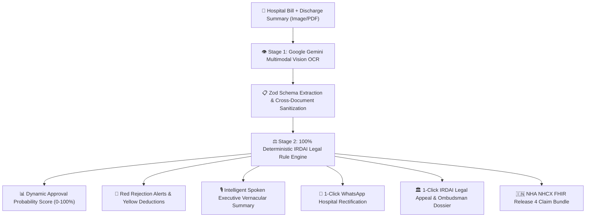

# 🛡️ ClaimKavach AI (क्लेमकवच)
> **Deterministic Micro-Insurance Claim Pre-Adjudication & Legal Compliance Engine for Bharat**  
> *Engineered for Hack with Delhi 4.0 | FinTech, Healthcare & Financial Inclusion*

[](https://nextjs.org/)
[](https://www.typescriptlang.org/)
[](https://tailwindcss.com/)
[](https://irdai.gov.in/)
[](https://github.com/NHA-ABDM)
[](https://clerk.com/)
[](https://ai.google.dev/)

---

## 📌 The Crisis: Micro-Insurance in Bharat

In India, low-income households, auto/cab drivers, gig workers (Zomato/Swiggy/Zepto), and rural families covered under **Ayushman Bharat (AB PM-JAY)**, **ESIC**, and retail micro-health insurance face a staggering **30%–45% claim rejection or abandonment rate**.

When catastrophic hospitalization strikes, families borrow from informal moneylenders at 36%–60% interest rates—slipping directly below the poverty line.

### Crucially: Over 82% of claim rejections are NOT fraud.
They are caused by **preventable clerical discrepancies**, misunderstood statutory regulations, and linguistic barriers:

```
┌────────────────────────────────────────────────────────────────────────┐
│                        WHY CLAIMS GET REJECTED IN INDIA                │
├────────────────────────────────┬───────────────────────────────────────┤
│ 📅 Cross-Document Date Clashes  │ Bill says Admit 10 May, Summary says  │
│                                │ 12 May (Immediate TPA Rejection)      │
├────────────────────────────────┼───────────────────────────────────────┤
│ 🧤 Prohibited Consumables      │ ₹3,000–₹8,000 billed for Gloves, PPE, │
│                                │ Crepe Bandages (IRDAI Lists I–IV)     │
├────────────────────────────────┼───────────────────────────────────────┤
│ ⏱️ 2024 Waiting Period Traps   │ Surgeries performed before statutory  │
│                                │ 36-month clause without clarification │
├────────────────────────────────┼───────────────────────────────────────┤
│ 🛏️ Proportional Room Capping   │ Room exceeds 1% of Sum Insured, so    │
│                                │ insurer cuts ALL doctor/surgery bills │
├────────────────────────────────┼───────────────────────────────────────┤
│ 🔏 Missing Treating Seals      │ Hospital clerk forgot doctor's seal   │
│                                │ or registration number on bill        │
├────────────────────────────────┼───────────────────────────────────────┤
│ 🗣️ English Legal Jargon        │ Patient gets a 6-page English notice  │
│                                │ and has no idea what to fix           │
└────────────────────────────────┴───────────────────────────────────────┘
```

---

## 💡 The Solution: ClaimKavach AI

**ClaimKavach AI** is a pre-submission adjudication platform that acts as a legal and financial shield for Indian families *before* their claims are submitted to insurance companies or TPAs.



---

## 🌟 Key Differentiators & Breakthrough Features

### 1. 🎙️ Intelligent Spoken Vernacular Summary (NOT Simple Text-to-Speech!)
Most apps simply feed raw on-screen text to a robot voice. **ClaimKavach AI features an active conversational diagnostic voice assistant:**
* **Diagnostic Focus on Unresolved Issues:** It selectively filters only the non-checked (unresolved) issues, explains them in authentic, comforting Hindi (`hi-IN`) or Indian English (`en-IN`), and ignores issues already resolved.
* **Quantifies Rupee Financial Risk:** Aloud, it states the exact monetary risk: *"In कमियों के कारण आपके बिल में लगभग ₹10,300 कटने या क्लेम निरस्त होने का खतरा है।"*
* **Real-Time Interactive Recalculation:** When a user checks **[ Mark as Fixed ]** in the audit report, the audio summary recalculates live. If all issues are resolved, it warmly congratulates the patient that their paperwork is 100% ready for full reimbursement!
* **High-Tactile Vernacular UI:** Engineered for vernacular and uneducated citizens with an oversized 96px tactile microphone, 16 animated waveform frequency bars, and single-tap language toggling.

### 2. ⚡ 2-Stage Hybrid Architecture (AI Vision + Deterministic Rule Engine)
* **Why not LLMs alone?** Large language models hallucinate arithmetic and legal guidelines. In health insurance, an incorrect calculation ruins financial lives.
* **The Hybrid Solution:** 
  * **Stage 1 (Gemini Vision):** Ingests messy, handwritten, stamped Indian hospital bills and clinical discharge summaries into clean structured JSON.
  * **Stage 2 (Deterministic Rule Engine):** Zero AI hallucination. Mathematical and statutory IRDAI 2024 compliance rules are evaluated through pure, auditable TypeScript code.

### 3. 🏥 1-Click WhatsApp Hospital Billing Counter Rectification
* When date mismatches or missing doctor seals are identified, families do not know what to ask the hospital billing desk.
* With 1 click, ClaimKavach auto-generates a formal, polite rectification notice in authentic internet Hindi (**"WhatsApp पर भेजें"**) or English.
* Automatically prepares the hospital bill dossier attachment, opens WhatsApp Web/mobile chat, and copies the message ready to forward to the hospital counter or TPA desk.

### 4. ⚖️ Real IRDAI 2024 Master Circular Statutory Protections Enforced
ClaimKavach is the first platform to encode the landmark **IRDAI Master Circular on Health Insurance (May 2024)**:
* **Chapter I, Para 13 (60-Month Moratorium):** Guarantees legal immunity against Pre-Existing Disease (PED) rejection for policies active for 5+ years (except in cases of established fraud).
* **3-Hour Cashless Discharge SLA:** Informs patients of their statutory right to discharge clearance within 3 hours of hospital authorization.
* **Proportionate Room Rent Capping:** Detects if ICU/Deluxe room costs exceed the policy's 1% Sum Insured cap, alerting the user before associated doctor and surgical charges are penalized.
* **IRDAI Non-Payable Lists I–IV:** Pre-audits gloves, PPE, crepe bandages, and administrative fees to calculate true out-of-pocket exposure.

### 5. 🏛️ 1-Click "Fight Back" IRDAI Legal Appeal & Ombudsman Dossier
* If a claim is unfairly rejected or delayed beyond statutory limits, ClaimKavach generates an official legal grievance letter addressed to the insurer's Grievance Redressal Officer (GRO).
* Cites mandatory 14-day resolution windows, IRDAI Bima Bharosa tokens, and the 3-step escalation to the **Office of the Insurance Ombudsman** (where policyholders historically win **79% of appeals**).

### 6. 🇮🇳 National Health Claims Exchange (NHCX / ABDM) Integration
* Generates official **HL7 FHIR Release 4 Claim Bundles** conforming strictly to the National Health Authority (NHA) ABDM and Swasth Alliance specifications.
* Bridges private micro-insurance with India's unified Digital Public Infrastructure (DPI).

### 7. ⚡ Interactive "Fix-It" Simulator
* Allows claimants or hospital counsellors to simulate remediating errors live.
* Ticking checkboxes dynamically raises the **Approval Probability Score** (e.g. **28% RED → 64% YELLOW → 96% GREEN**) with live confetti celebrations and money saved counters.

### 8. 🔒 Cryptographic SHA-256 Tamper-Evident Dossier with 100% Scannable QR Code

ClaimKavach AI generates an **Official Executive A4 Compliance Certificate** equipped with cryptographic tamper-evident authentication:

<div align="center">
  <br />
  <a href="https://github.com/Aditya-kumar-yadav/ClaimKavach-AI/blob/main/public/ClaimKavach_Pre_Adjudication_Dossier.pdf" target="_blank">
    
  </a>
  <br />
  <p><strong>📱 Try it now: Point your smartphone camera or Google Lens at this QR code!</strong></p>
  <p>
    <a href="https://github.com/Aditya-kumar-yadav/ClaimKavach-AI/blob/main/public/ClaimKavach_Pre_Adjudication_Dossier.pdf">
      <b>📄 Click Here to Open Full A4 Pre-Adjudication Dossier (PDF)</b>
    </a>
  </p>
  <br />
</div>

* **Universal Mobile Verification:** Anyone (patients, TPA desk clerks, hospital superintendents, hackathon judges) can scan the QR code using any smartphone camera with **zero apps installed**. It immediately opens the authentic pre-adjudication certificate in their mobile browser.
* **Non-Repudiable Cryptographic Integrity:** Every evaluated claim generates a deterministic **SHA-256 digital fingerprint** encoding all line items, statutory deductions, ICD-10 diagnosis codes, and hospital registration numbers. Any alteration to dates or amounts invalidates the hash.
* **1-Page Executive Format:** Structured to standard A4 printing constraints with zero browser headers/footers (`@page { size: A4; margin: 8mm; }`), complete with hospital seal stamp blocks and authorized medical officer sign-off lines.
* **In-App Lightbox Preview:** Users can inspect the certificate right inside the web application via the **"Preview Dossier (डोजियर देखें)"** modal prior to physical printing.

---

## 🏛️ Statutory Rules Enforced

| Statutory Regulation | Legal Reference | How ClaimKavach Enforces It |
| :--- | :--- | :--- |
| **5-Year Moratorium Clause** | IRDAI Master Circular (May 2024), Para 13 | Policies $\ge 60$ months gain legal immunity against PED contestation (except established fraud). |
| **Procedure Waiting Periods** | Standardized Health Circular (2024) | Enforces 36-month statutory cap (Hernia, Cataract, Joint Replacement) and flags premature claims. |
| **Room Rent Proportional Capping** | Schedule of Benefits (1% SI Limit) | Calculates proportional penalty on all linked expenses if room rent exceeds 1% of Sum Insured. |
| **Non-Payable Consumables** | IRDAI Non-Payable Lists I–IV | Audits surgical consumables (gloves, PPE, masks, bandages, admission fees) and segregates deductions. |
| **Cross-Document Date Reconciliation** | IRDAI Claim Adjudication Guidelines | Flags cross-document admit/discharge date mismatches that trigger automatic TPA rejection. |
| **Treating Doctor Registration Seal** | Medical Council / IRDAI Statutory Mandate | Checks doctor registration number and signature integrity on billing records. |
| **Cashless Everywhere & Benchmark** | NHA PM-JAY Tariff System (2024) | Compares billed surgical package against national PM-JAY benchmark tariffs to catch private overbilling. |

---

## 🎯 5 Built-in Real-World Scenarios

Easily test any case via the top navigation scenario selector:

| Scenario | Diagnosis & Procedure | Billed Total | Expected Audit Outcome | Key Statutory Rules Triggered |
| :--- | :--- | :--- | :--- | :--- |
| **1. Date Mismatch & Seal Error** | Acute Appendicitis (Appendectomy) | ₹38,850 | **Critical Rejection Risk (28%)** | Date discrepancy between bill & summary; missing doctor seal; non-payable consumables. |
| **2. PM-JAY Overbilling** | Cholelithiasis (Laparoscopic Cholecystectomy) | ₹68,000 | **Overbilling Alert (52%)** | Billed at 3.1x the PM-JAY national benchmark rate (₹22,000); itemized deductions. |
| **3. 36-Month Waiting Period** | Severe Osteoarthritis (Total Knee Replacement) | ₹1,45,000 | **Statutory Breach (34%)** | Procedure falls under statutory 36-month waiting period on a 14-month active policy. |
| **4. Room Rent Capping** | Dengue Fever with Severe Thrombocytopenia | ₹52,000 | **Severe Deductions (48%)** | Room rent billed at ₹5,000/day against ₹3,000/day (1% cap), triggering proportional cuts. |
| **5. Clean / Moratorium Protected** | Coronary Artery Disease (Angioplasty) | ₹1,85,000 | **Full Approval (96% Green)** | Policy tenure 68 months — 100% protected under IRDAI Para 13 Moratorium Clause. |

---

## 🏗️ Architecture & Technical Stack

```
ClaimKavach AI Architecture
├── Frontend (Client Layer)
│   ├── Next.js 14 (App Router, Server & Client Components)
│   ├── Tailwind CSS + Framer Motion (Responsive Glassmorphic UI)
│   ├── Lucide Icons & Canvas Confetti
│   ├── Tactile Vernacular Audio Assistant (Web Audio API + Waveform Canvas)
│   └── Clerk v5 Authentication (Multi-session, Zero-delay Profile Skeleton)
│
├── API Handlers (/app/api/)
│   ├── /api/extract ───────> Multimodal Gemini 3.5 Flash Vision OCR
│   ├── /api/validate ──────> 100% Deterministic IRDAI Legal & Deduction Engine
│   ├── /api/tts ───────────> Generative Vernacular Speech Synthesizer
│   └── /api/validate-key ──> Real-time Google AI Studio API Key Verifier
│
└── Interoperability & DPI Standards
    ├── HL7 FHIR Release 4 Claim Bundle Generator (NHA-ABDM compliant)
    ├── SHA-256 Cryptographic Dossier Integrity Generator
    └── WhatsApp Universal Web & Mobile Intent Protocol
```

---

## 🚀 Quickstart & Local Installation

### Prerequisites
* **Node.js:** v18.17.0 or higher
* **Package Manager:** npm or yarn

### 1. Clone the Repository
```bash
git clone https://github.com/Aditya-kumar-yadav/ClaimKavach-AI.git
cd ClaimKavach-AI
```

### 2. Install Dependencies
```bash
npm install
```

### 3. Configure Environment Variables
Create a `.env.local` file in the root directory:
```env
# Google Gemini API Key (for Multimodal Document OCR & TTS)
GEMINI_API_KEY=your_gemini_api_key_here

# Clerk Authentication Keys
NEXT_PUBLIC_CLERK_PUBLISHABLE_KEY=your_clerk_publishable_key
CLERK_SECRET_KEY=your_clerk_secret_key
NEXT_PUBLIC_CLERK_SIGN_IN_URL=/sign-in
NEXT_PUBLIC_CLERK_SIGN_UP_URL=/sign-up
NEXT_PUBLIC_CLERK_AFTER_SIGN_IN_URL=/
NEXT_PUBLIC_CLERK_AFTER_SIGN_UP_URL=/
```
*(Note: A free API key can also be entered directly into the application UI via the "API Key" button on the header).*

### 4. Run Development Server
```bash
npm run dev
```
Open [http://localhost:3000](http://localhost:3000) (or `http://localhost:3001`) in your browser.

---

## 🎯 The 60-Second Hackathon Judge Demo Walkthrough

Follow these steps to demonstrate maximum innovation in 60 seconds:

1. **Step 1 (The Hook):** Open the app. Point out the vernacular toggle (`हिंदी / EN`) and select **"सैंपल: खारिज होने वाला क्लेम (Date Mismatch & Seal Error)"**.
2. **Step 2 (The Audit):** Click **"क्लेम की जाँच करें (Pre-Adjudicate Claim)"**. Watch the **Approval Probability Meter** drop to **28% (Critical Red)**.
3. **Step 3 (The Audio Differentiator):** Tap the **Vernacular Voice Assistant (Mic)**:
   * Listen as it dynamically diagnoses only the unresolved errors in natural spoken Hindi:
     > *"ध्यान दें! मरीज के कुल ₹38,850 के बिल में कागजी कमियां बाकी हैं। अस्पताल बिल और डिस्चार्ज समरी में भर्ती की तारीख अलग-अलग है..."*
4. **Step 4 (The Live Simulation):** Click **[ Mark as Fixed ]** on the Date Mismatch error.
   * Watch the score jump live to **64%** and the audio assistant immediately recalculate remaining issues.
5. **Step 5 (Hospital Remediation):** In any issue card, point out the green **"WhatsApp पर भेजें"** button:
   * Shows a pre-composed hospital correction notice with bill attachment ready to send to the billing counter.
6. **Step 6 (The DPI Flex):** Click **"NHCX FHIR JSON देखें"**:
   * Inspect the official 5-resource HL7 FHIR Bundle compliant with India's National Health Claims Exchange.
7. **Step 7 (The Legal Protection Flex):** Switch the scenario dropdown to **"100% Moratorium Protected Pass"**:
   * Show the green statutory badge: **IRDAI 2024 Master Circular Para 13 (60-Month Moratorium on Rejections)**!
8. **Step 8 (The Physical Proof & Live QR Scan):** Click **"Preview Dossier"** or **"Print Dossier (A4)"**:
   * Inspect the official pre-adjudication compliance certificate.
   * Point any smartphone camera at the **embedded QR code** — it instantly scans and loads the authentic PDF on your mobile device!

---

## 👥 Built with ❤️ by Team ClaimKavach
* **Aditya Yadav** & Team  
* *Hack with Delhi 4.0 | Track 1: FinTech & Financial Inclusion*
